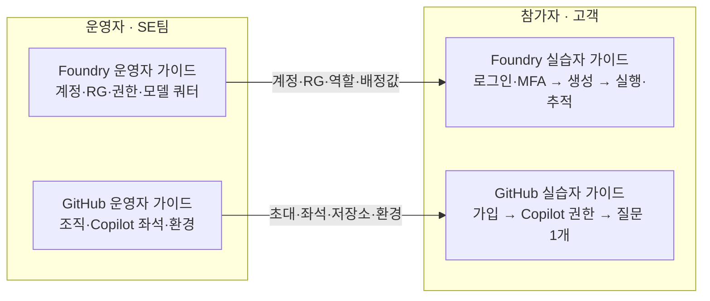

# Microsoft Foundry · GitHub Copilot 고객 Hands-on Workshop 가이드

고객 약 **70명이 5시간** 동안 Microsoft Foundry와 GitHub Copilot을 직접 실습하는 워크샵의 **실습자·운영자 가이드**입니다. **SE 테스트 5개를 포함해 Azure 계정·RG 75개**를 준비합니다.

> 운영자가 **계정·리소스 그룹(RG)·권한**과 GitHub 조직·Copilot 좌석을 준비하고, 참가자는 **본인 RG 안에서 Foundry·프로젝트·모델·관측성을 직접 만듭니다.**

## 어떤 가이드를 보나요?

| 나는… | Foundry | GitHub · Copilot |
|---|---|---|
| **참가자(실습자)** | [Foundry 실습자 가이드](https://junwoojeong100.github.io/internal-guest-hands-on-guide/)<br>로그인·MFA → 리소스 생성 → 실행·추적 | [GitHub 실습자 가이드](https://junwoojeong100.github.io/internal-guest-hands-on-guide/github-copilot.html)<br>가입 → Copilot 권한 → 질문 1개 |
| **운영자(SE)** | [Foundry 운영자 가이드](https://junwoojeong100.github.io/internal-guest-hands-on-guide/operator.html)<br>역할 → 스크립트/포털 → 필수 점검 → 인계·종료 | [GitHub 운영자 가이드](https://junwoojeong100.github.io/internal-guest-hands-on-guide/github-copilot-operator.html)<br>가입 방식 → 좌석·정책 → 리허설 → 인계·종료 |



모든 가이드는 라이트/다크 테마를 지원하고, 명령·JSON·질문·인계 템플릿에는 **복사 버튼**이 있습니다. Foundry 실습자 가이드에는 63장의 실제 화면, 3분 요약 영상, 51분 전체 영상이 포함됩니다.

## 운영자 빠른 시작 · Azure 계정·RG·권한 일괄 준비

**Azure Cloud Shell Bash(영구 저장소), Linux/macOS 또는 WSL · Python 3.11+ · Azure CLI**가 필요하며 추가 Python 패키지는 없습니다. 소규모·수동 준비는 [B · 포털 절차](https://junwoojeong100.github.io/internal-guest-hands-on-guide/operator.html#portal)를 따르고, 같은 환경에 A/B를 중복 실행하지 않습니다.

```bash
git clone https://github.com/junwoojeong100/internal-guest-hands-on-guide.git
cd internal-guest-hands-on-guide
cp config/workshop.example.json config/workshop.local.json
# local.json의 tenantId·subscriptionId·고유 workshopId·지역·계정 수를 확인/수정한 뒤 로그인합니다.
az login --tenant "REPLACE_WITH_TENANT_ID"

# 1) 읽기 전용 계획 (기본값: 계정·RG·역할·암호 파일을 만들지 않습니다)
python3 scripts/provision_workshop.py --config config/workshop.local.json

# 2) 검토한 계획을 실제 적용
python3 scripts/provision_workshop.py --config config/workshop.local.json --apply

# 3) 실제 Graph/ARM 상태를 다시 읽어 독립 검증 (실패 시 종료 코드 1)
python3 scripts/verify_workshop.py --config config/workshop.local.json
```

예제 설정(`participantCount=75`, `seTestAccountCount=5`, `nameFormat="user-se"`)은 **고객 `user01`~`user70` + SE 테스트 `se01`~`se05`** 계정, RG `rg-user01`~`rg-user70`·`rg-se01`~`rg-se05`, 직접 RBAC **225개**를 만듭니다. 이름 충돌·재실행·복구·비공개 파일 취급은 [운영자 가이드 A](https://junwoojeong100.github.io/internal-guest-hands-on-guide/operator.html#automation)를 따르세요.

## 꼭 지킬 기준

| 주제 | 기준 |
|---|---|
| 참가자 권한 | **본인 RG의 Contributor·Foundry User + 구독의 Cognitive Services Usages Reader**. Entra 관리자 역할은 없습니다. 운영자 Owner 권한은 참가자에게 전달되지 않습니다. |
| 첫 로그인 | 초기 암호 그대로 로그인하며 변경을 강제하지 않습니다(`forceChangePasswordNextSignIn=false`). **MFA 등록·인증은 본인이 완료**하고 MFA·조건부 액세스는 해제하지 않습니다. |
| 인계 전 필수 | **실제 교육망에서 MFA 미등록 테스트 Guest 2개의 첫 로그인·MFA 등록·재로그인**을 확인합니다. 스크립트 PASS나 운영자 계정 성공으로 대신하지 않습니다. |
| 모델·TPM | 일반 실습은 **`gpt-6.1-terra`를 개인별 TPM으로 배분**합니다((70 + 5) × 10,000 = 750,000 TPM은 계산 예시). Optimizer 등 모델 고정 설정은 지정 모델을 유지합니다. |
| 관측성 | 참가자가 Agent → Traces → **Connect → Create new resource**로 Application Insights를 본인 RG에 만들고 바로 연결합니다. |
| 비공개 파일 | `.workshop-runs/<workshopId>/`(초기 암호 포함)는 Git·Pages에서 제외하고 승인된 비공개 저장소에 백업합니다. 참가자 암호는 별도 경로로 개별 전달합니다. |
| GitHub | 조직 가입·Copilot 좌석·Codespaces는 **각각 별도 승인·과금**입니다. Azure 계정 스크립트는 GitHub 계정·초대·좌석을 만들지 않습니다. |

## 검증 현황

- **확인한 것:** Internal Guest 1명의 기본 Prompt Agent E2E(2026.11.05, GPT-5 mini)와 새 Guest 1개의 초기 암호 + Software OATH(TOTP) MFA 로그인(2026.11.08). [비밀 값 없는 검증 JSON](assets/guest-auth-verification.json)을 제공합니다.
- **아직 확인하지 않은 것:** 75개 환경 생성·동시 부하, `gpt-6.1-terra` E2E, 고객 교육망, Microsoft Authenticator 푸시, GitHub 좌석 사용, Traces의 Create new resource 이후 화면(녹화에는 Azure Portal 사전 생성 방식만 있음). 개최 전 운영자 가이드의 필수 점검으로 확인하세요.
- **오프라인 테스트:** Azure에 접속하지 않고 스크립트와 가이드 링크·앵커를 검사합니다.

```bash
python3 -m unittest discover -s tests -v
```

## 배포

`main`에 푸시하면 GitHub Actions가 위 테스트를 통과한 뒤 HTML·영상·공개 스크립트·예제 설정만 빌드해 GitHub Pages에 배포합니다. CI는 Azure 계정·RG·역할을 만들지 않습니다. 화면 출처·재사용 조건은 [ATTRIBUTION](assets/onboarding/ATTRIBUTION.txt)에 있습니다.
